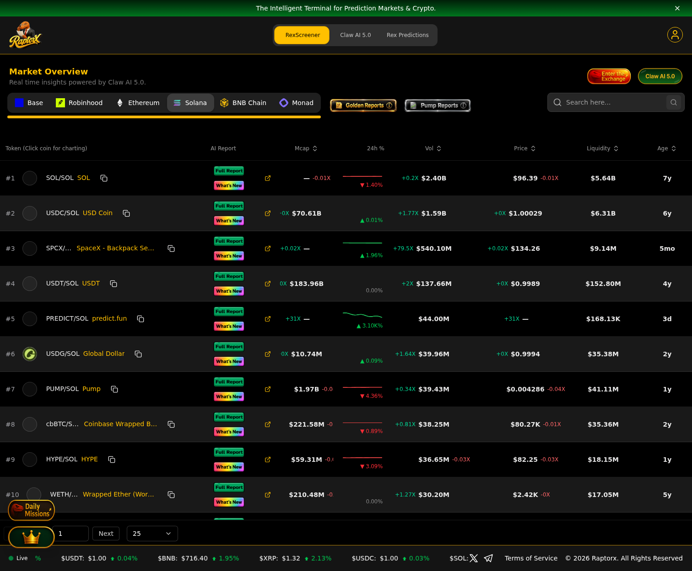
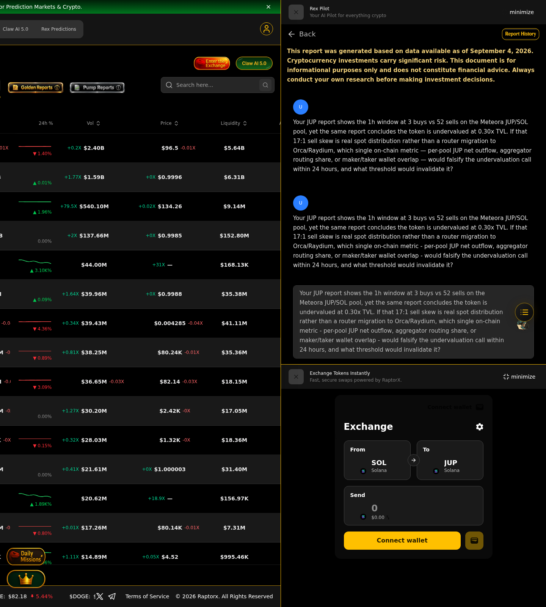
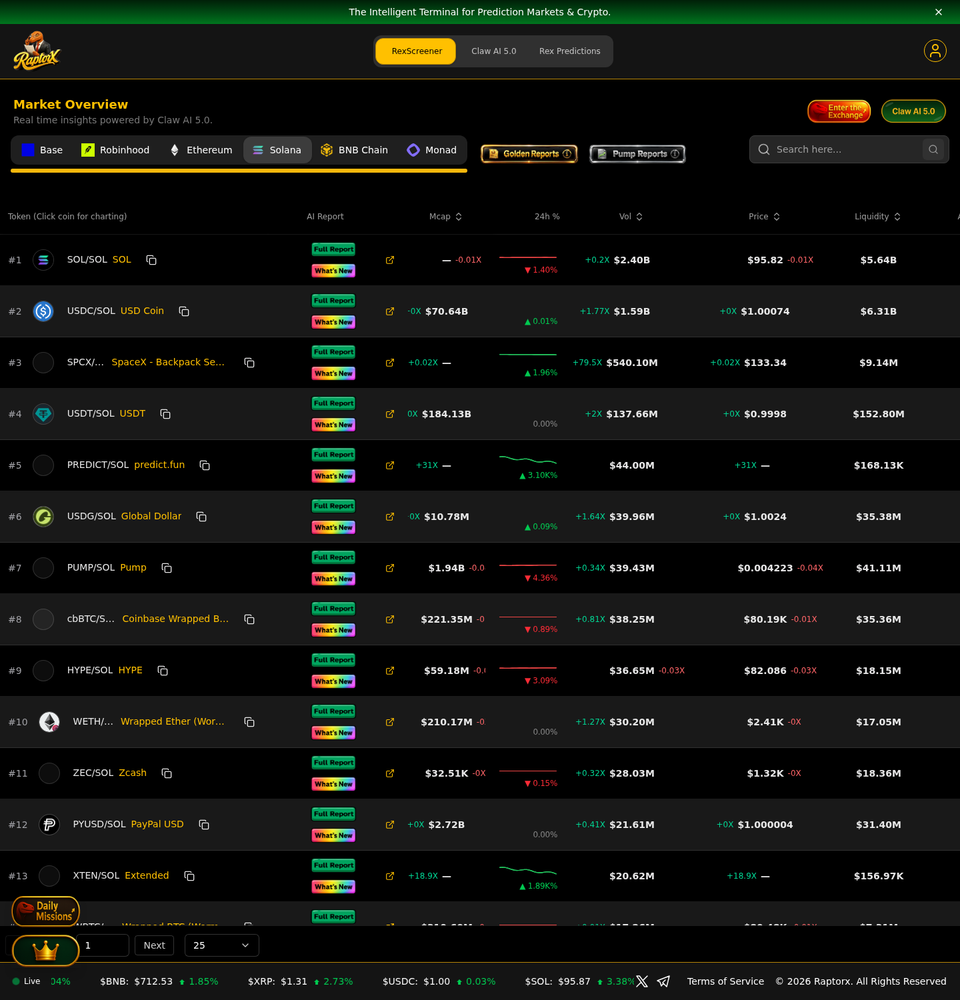
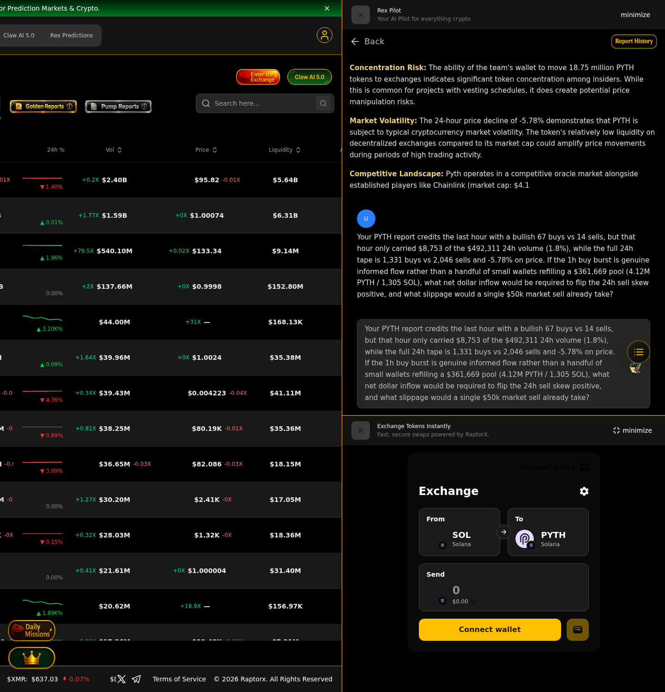
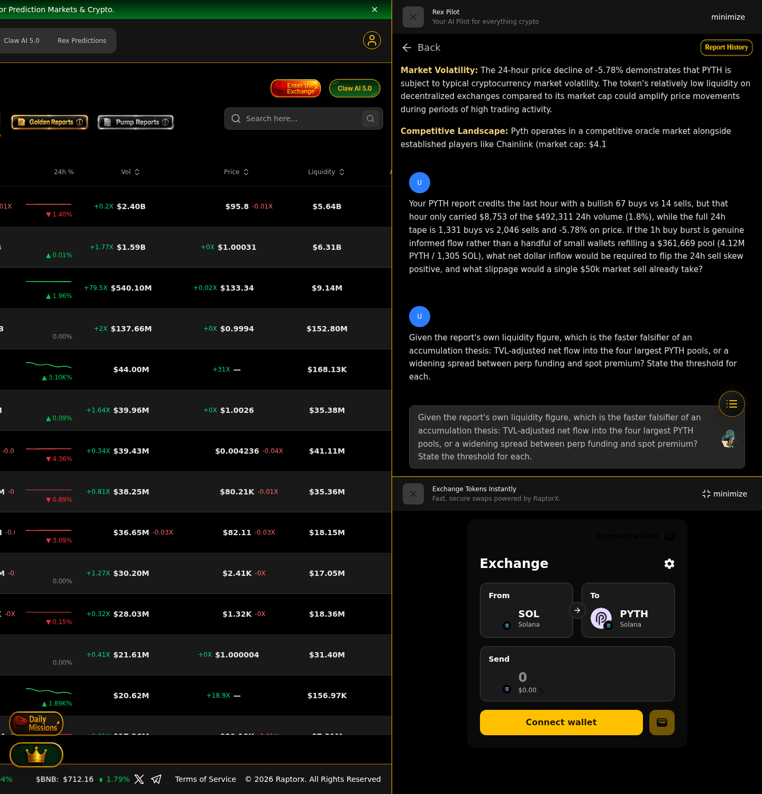
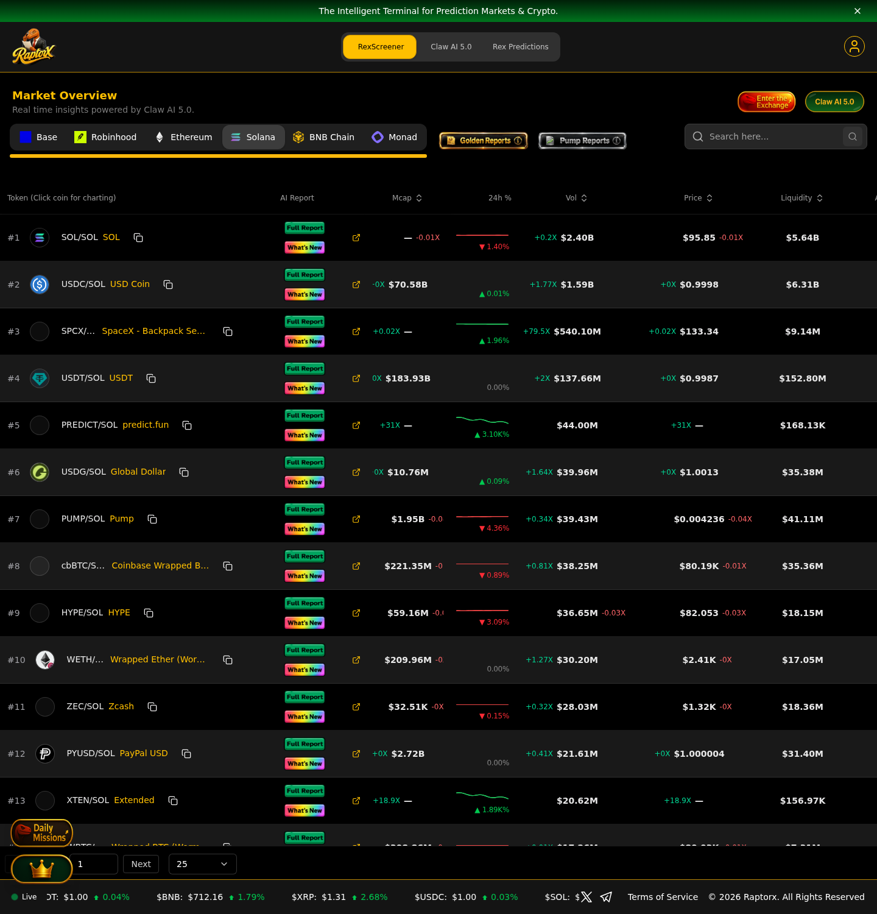
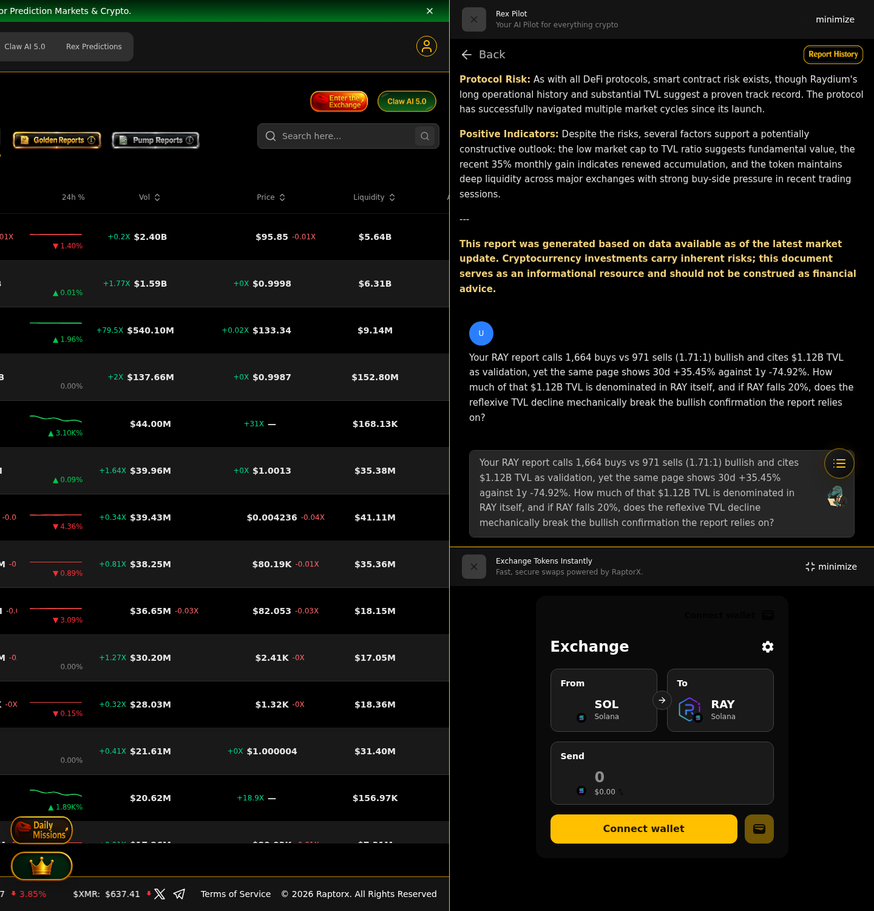
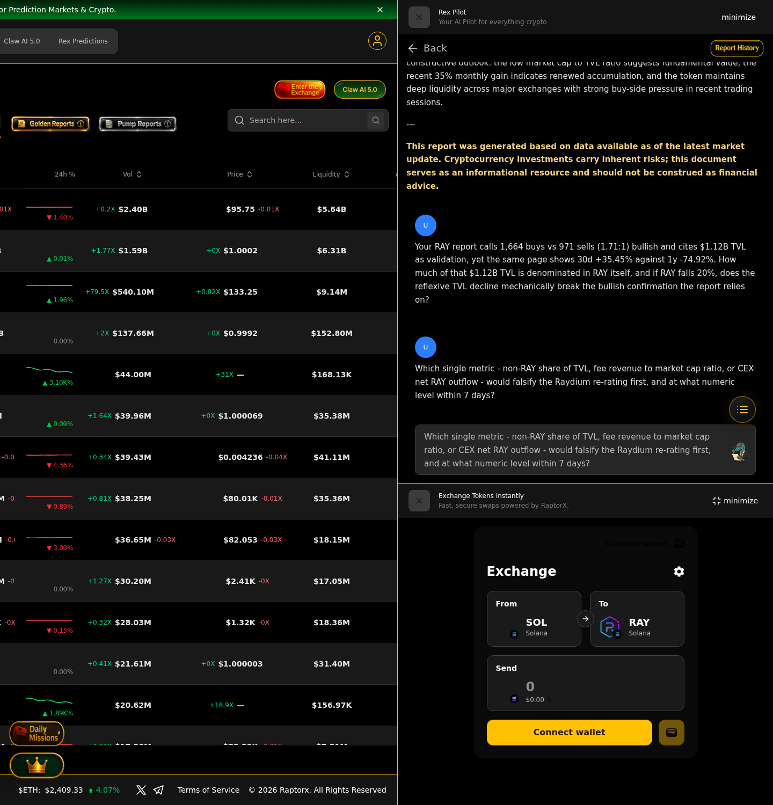

# RaptorX Research Challenge — Entry Evidence

Bounty: **RaptorX Research Challenge: Ask Better Questions. Find Better Alpha.** (Superteam Earn)

All reports were generated inside RaptorX (Rex Pilot / REX AI 5.0) with an account that is NOT attached to this
submission's identity, and every question was asked in the RaptorX follow-up box on top of the report itself.

## Summary — 4 Solana assets, 7 falsifiable questions

| Asset | Report | Questions asked |
|---|---|---|
| Wrapped SOL | [sol-report.png](sol-report.png) | 1 (buy/sell skew vs 7d/30d gap) |
| Jupiter (JUP) | [jup-report.png](jup-report.png) | 1 (17:1 sell skew vs 0.30x TVL) |
| Pyth Network (PYTH) | [pyth-report.png](pyth-report.png) | 2 (1h burst vs 24h sell tape; falsifier ranking) |
| Raydium (RAY) | [ray-report.png](ray-report.png) | 2 (reflexive TVL; falsifier threshold) |

---

## 1. Wrapped SOL — report and question

> The SOL report shows 24h buys 42,614 vs sells 44,535 (48.9% buy share) and volume/liquidity at 5.56x,
> yet 7d is -2.05% while 30d is +41.01%. If the 5.56x turnover is real demand rather than wash recycling, which
> on-chain variable - unique maker wallets, Orca pool net SOL outflow, or perp funding vs spot premium - should
> resolve that 7d/30d contradiction first, and what reading would prove the rally is exhausted?

## 2. Jupiter (JUP) — report and question

> Your JUP report shows the 1h window at 3 buys vs 52 sells on the Meteora JUP/SOL pool, yet the same report
> concludes the token is undervalued at 0.30x TVL. If that 17:1 sell skew is real spot distribution rather than
> a router migration to Orca/Raydium, which single on-chain metric - per-pool JUP net outflow, aggregator routing
> share, or maker/taker wallet overlap - would falsify the undervaluation call within 24 hours, and what threshold
> would invalidate it?

## 3. Pyth Network (PYTH) — report and two questions

Q1 — the report credits the last hour with a 67:14 buy skew, but that hour carried only $8,753 of the $492,311
24h volume (1.8%) while the full tape is 1,331 buys vs 2,046 sells at -5.78%:

> If the 1h buy burst is genuine informed flow rather than a handful of small wallets refilling a $361,669 pool
> (4.12M PYTH / 1,305 SOL), what net dollar inflow would be required to flip the 24h sell skew positive, and what
> slippage would a single $50k market sell already take?

Q2 — which is the faster falsifier of an accumulation thesis: TVL-adjusted net flow into the four largest PYTH
pools, or a widening spread between perp funding and spot premium? State the threshold for each. (asked in the
same thread; see pyth-question-2.png)

## 4. Raydium (RAY) — report and two questions

Q1 — bullish 1.71:1 buy ratio and $1.12B TVL cited as validation, against 30d +35.45% versus 1y -74.92%:

> How much of that $1.12B TVL is denominated in RAY itself, and if RAY falls 20%, does the reflexive TVL decline
> mechanically break the bullish confirmation the report relies on?

Q2 — which single metric (non-RAY share of TVL, fee revenue / market cap, or CEX net RAY outflow) falsifies the
re-rating first, and at what numeric level within 7 days?

---

### Why these questions

Each question attacks a contradiction that already exists inside the generated report (1h momentum vs 24h tape,
reflexive TVL vs TVL-as-validation, sell skew vs undervaluation), converts it into a numeric threshold, and names
the specific on-chain series that would settle it within 24 hours to 7 days — instead of asking the model to
predict price.
