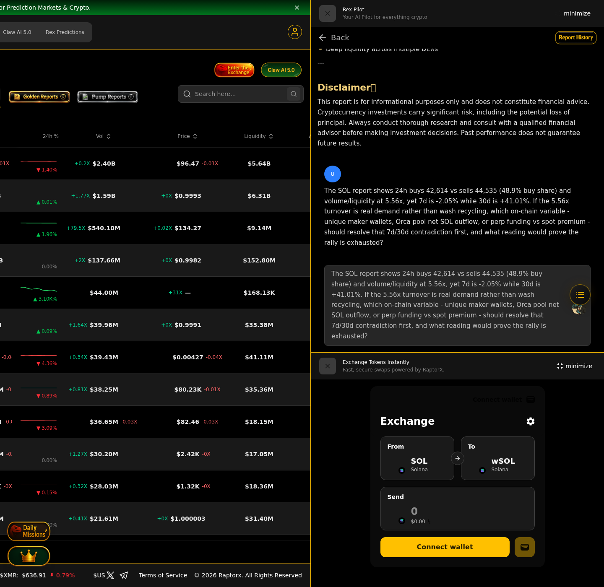

# RaptorX Research Challenge — Evidence

Bounty: Superteam Earn / RaptorX Research Challenge: Ask Better Questions. Find Better Alpha.

## 1. AI-generated report (RaptorX, Wrapped SOL / $SOL)

The report was generated inside RaptorX (Rex Pilot, authenticated account) and is visible in the
"Rex Pilot" panel with the platform navigation and branding.

Key figures used for the follow-up: 24h buys 42,614 vs sells 44,535 (48.9% buy share), An estimated
volume/liquidity turnover of ~5.56x on the Orca SOL/USDC pool, 7d -2.05% versus 30d +41.01%, ATH drawdown
~64%, Fear & Greed 74, spot ETF net inflow $6.4M.

## 2. Follow-up question asked to the RaptorX AI

> The SOL report shows 24h buys 42,614 vs sells 44,535 (48.9% buy share) and volume/liquidity at 5.56x,
> yet 7d is -2.05% while 30d is +41.01%. If the 5.56x turnover is real demand rather than wash recycling,
> which on-chain variable - unique maker wallets, Orca pool net SOL outflow, or perp funding vs spot premium -
> should resolve that 7d/30d contradiction first, and what reading would prove the rally is exhausted?

## 3. Second question (Jupiter / $JUP, same account)

> Your JUP report shows the 1h window at 3 buys vs 52 sells on the Meteora JUP/SOL pool, yet the same report
> concludes the token is undervalued at 0.30x TVL. If that 17:1 sell skew is real spot distribution rather than
> a router migration to Orca/Raydium, which single on-chain metric - per-pool JUP net outflow, aggregator routing
> share, or maker/taker wallet overlap - would falsify the undervaluation call within 24 hours, and what
> threshold would invalidate it?

Both questions target a contradiction inside the generated report and are falsifiable within 24h,
instead of generic "what is the price outlook" prompts.
